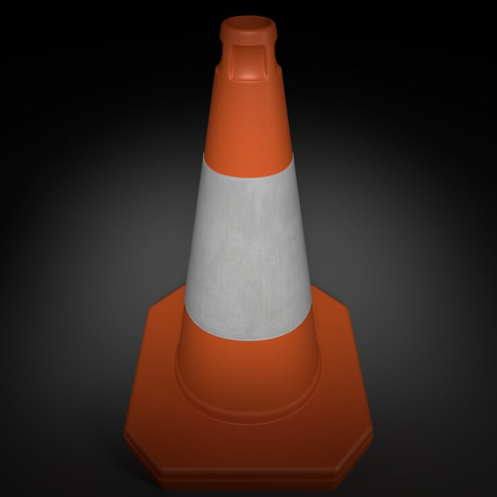
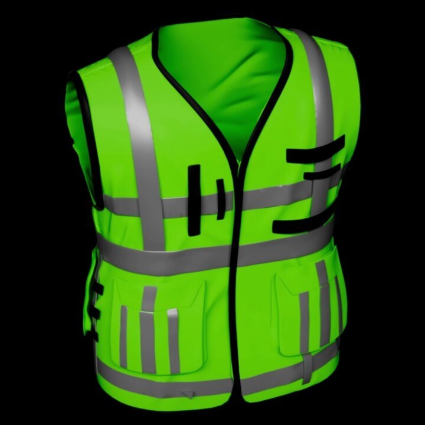
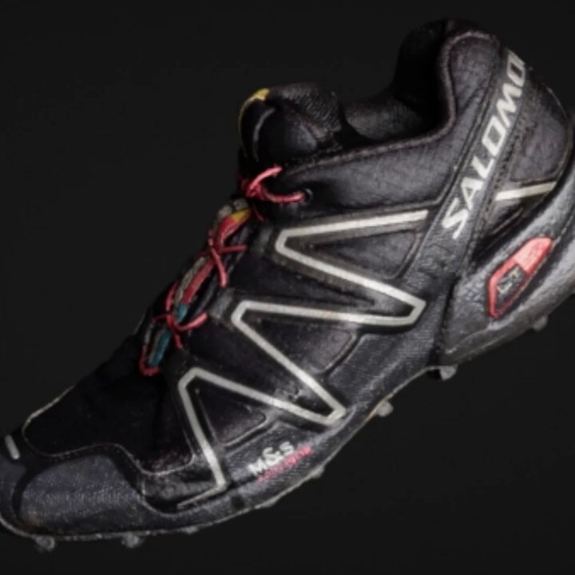
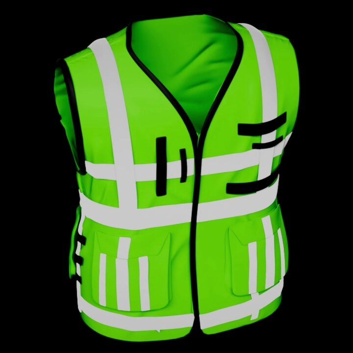
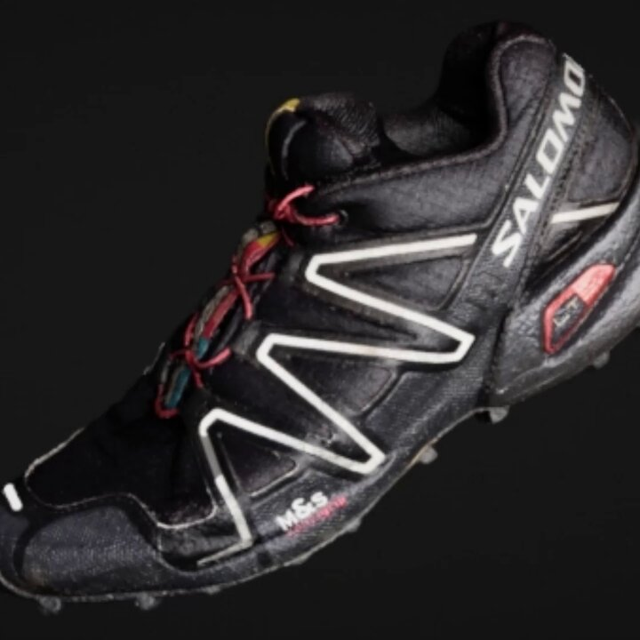

    GGX
    

        

        

        

    

    MRM
    

        

        

        

    

Renderings of our MRM model (bottom row) obtained by an almost trivial modification of the equivalent roughness GGX microfacet model (top row). The lighting in all cases is aligned with the view direction, exhibiting a strong retroreflective peak in the MRM model.

 

    

        <video loop controls style="width:100%; border:solid 1px black;">
            <source src="/videos/publication_2026_mrm_jacket_ggx.mp4" type="video/mp4">
        </video>
        
<strong>GGX</strong>

    

    

        <video loop controls style="width:100%; border:solid 1px black;">
            <source src="/videos/publication_2026_mrm_jacket_mrm.mp4" type="video/mp4">
        </video>
        
<strong>MRM</strong>

    

 

## Abstract

We describe the Minimal Retroreflective Microfacet (MRM) model, which provides a simple scheme for modifying a pre-existing microfacet BSDF implementation to produce a physically plausible retroreflective result. Based on the previously published back-vector formulation, MRM can be implemented with minimal changes to existing microfacet code, making it easy to integrate into existing rendering systems. We provide verification of reciprocity (under the assumption of a reflection-symmetric normal distribution function (NDF), which holds for all commonly used distributions) energy conservation, implementation details, and a comparison to measured data.
